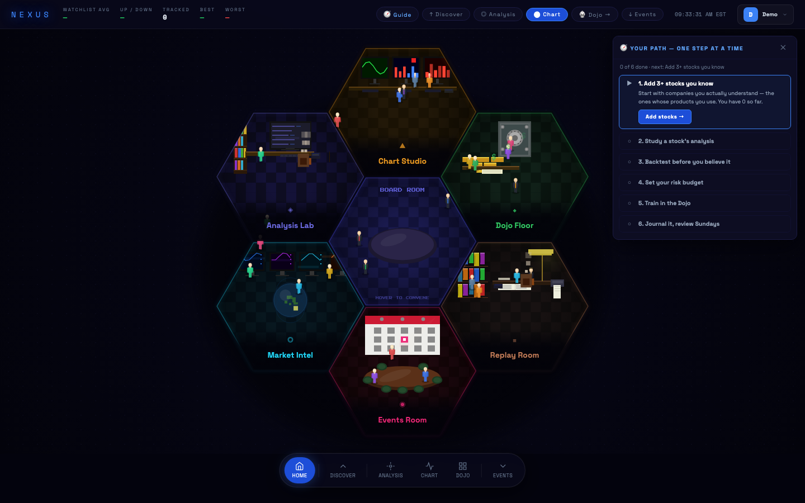

# NEXUS: Stock Intelligence Platform

A complete stock research, forecasting and portfolio app in a **single HTML file**: no build step, no backend, and it runs entirely in the browser.



## Features
- **Animated hub.** A canvas-drawn hexagonal "office" with pixel-art analysts walking between rooms. Each room opens a section of the app.
- **Live market data** from Yahoo Finance through rotating CORS proxies, with a two-layer cache (memory + localStorage) and TTLs.
- **Technical-analysis library written from scratch:** EMA, SMA, RSI, MACD, Bollinger Bands, ATR, ADX, OBV and Stochastic, all as pure functions over OHLCV data.
- **Signal and confidence engine** that combines the indicators into a directional call with a confidence score.
- **Forecast engine** that blends signals, ATR-calibrated event impacts and drift into a price forecast with a confidence band.
- **Backtester:** walk-forward direction hit rate, plus a long-only strategy P&L compared against buy-and-hold. A **forecast track record** scores past predictions once they mature, so the app is honest about its own accuracy.
- **Edge scanner** that backtests the whole watchlist and ranks each stock TRADE / JUST HOLD / AVOID.
- **Portfolio tracker** with a trade log and FIFO lot matching (realized and unrealized P&L, win rate), plus risk-based position sizing.
- **Chart drawing tools** (trendlines and more) and price alerts.
- **Day-Trade Dojo:** chart-pattern flashcards with spaced repetition, plus a market replay mode that replays a real past trading day bar by bar under strict risk rules.
- **Beginner coach:** a step-by-step checklist that teaches a safe research workflow.
- **Multiple profiles** saved in localStorage, plus Markdown journal exports for Obsidian.

## Run it
```bash
python3 -m http.server 8000
# open http://localhost:8000
```

Vanilla JavaScript, Canvas 2D and Chart.js. Built with help from AI coding tools (Claude Code). Not financial advice.
